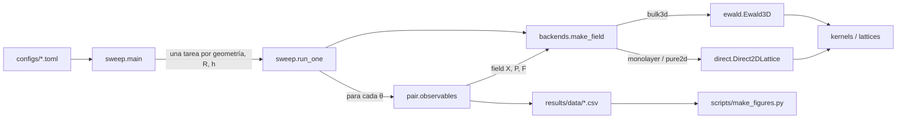

# swimmers-ewald

Sumas hidrodinámicas en red para clusters de pares de spinners antiparalelos en flujo de Stokes.
Es una reimplementación en Python, corregida y validada, del código Racket (`base_sums.rkt`) usado en el artículo
*Active motion and stability of a cluster of antiparallel spinners* (Córdoba, Martinod, Schieber).

[](https://github.com/th-martinod/swimmers-ewald/actions/workflows/tests.yml)

**Resultados principales** (detalle en [`RESULTS.md`](RESULTS.md)):

- El criterio de advección $\dot Q=v(r_2)-v(r_1)$ da rotación **nula exactamente** en cualquier red de Bravais, por simetría de inversión.
- El criterio del artículo ($V_{\rm conf}$, ec. 5) bien calculado da θ = 0 **inestable** en la red hexagonal y puntos estables en θ = ±π/6, en las tres geometrías.
- La velocidad de traslación es casi la del par aislado. La red la corrige en menos de 2.5 %.
- Los defectos del código original están documentados y reproducidos en [`docs/LEGACY_DEFECTS.md`](docs/LEGACY_DEFECTS.md).
- **Todas las figuras de datos del artículo y del SI**, corregidas, están en `results/figures/paper/`. La correspondencia está en [`docs/FIGURE_MAP.md`](docs/FIGURE_MAP.md).

---

## Contenido

1. [Instalación y prueba rápida](#1-instalación-y-prueba-rápida)
2. [Mapa del repositorio](#2-mapa-del-repositorio)
3. [Cómo fluye un cálculo](#3-cómo-fluye-un-cálculo)
4. [Recorrido por el código, en orden de lectura](#4-recorrido-por-el-código-en-orden-de-lectura)
5. [Geometrías](#5-geometrías)
6. [Observables y columnas de los CSV](#6-observables-y-columnas-de-los-csv)
7. [Convenciones y unidades](#7-convenciones-y-unidades)
8. [Tests: qué garantiza cada uno](#8-tests-qué-garantiza-cada-uno)
9. [El código original (`legacy.py`)](#9-el-código-original-legacypy)
10. [Reproducir todos los resultados](#10-reproducir-todos-los-resultados)
11. [Cómo extender el código](#11-cómo-extender-el-código)
12. [Limitaciones conocidas](#12-limitaciones-conocidas)

---

## 1. Instalación y prueba rápida

Requiere Python ≥ 3.10 (se usa `tomllib`, incluido desde 3.11, o el paquete `tomli` en 3.10).

```bash
git clone https://github.com/th-martinod/swimmers-ewald
cd swimmers-ewald
pip install -e ".[test]"
pytest -q                     # 25 tests, ~3 s
```

Un cálculo suelto desde Python:

```python
from spinners.backends import make_field
from spinners.pair import observables

field, kernel = make_field("bulk3d", "hex", h=5.0)      # red hexagonal 3D, Q/h = 0.2
obs = observables(field, theta=0.2, Q=1.0, R=0.5, kernel=kernel)
print(obs["A_conf"], obs["omega_qdot"], obs["U_perp"])
```

## 2. Mapa del repositorio

```
swimmers-ewald/
├── src/spinners/            el paquete (≈450 líneas en total)
│   ├── lattices.py          redes de Bravais (scl, bcl, fcl, hex), red recíproca, puntos de red por radio
│   ├── kernels.py           Stokeslet libre 3D y 2D aplicados a una fuerza
│   ├── ewald.py             Stokeslet triplemente periódico (Ewald de Hasimoto/Beenakker)
│   ├── direct.py            sumas directas en redes 2D con extrapolación del radio de corte
│   ├── pair.py              geometría del par (ec. 1), V_conf (ec. 5), Qdot y U  ← el corazón físico
│   ├── backends.py          elige el campo según la geometría (bulk3d, monolayer, pure2d)
│   ├── sweep.py             barridos de parámetros desde un .toml, salida en CSV (comando spinners-sweep)
│   └── legacy.py            port fiel del Racket de producción, solo para regresión y diagnóstico
├── tests/                   pytest: validación numérica, simetrías y regresión contra legacy
├── configs/                 paper.toml (todas las figuras del artículo), hex.toml, scl_control.toml
├── scripts/
│   ├── paper_figures.py     versiones corregidas de las Figs. 2-5, 7, S1-S6 y extras de 2D puro
│   ├── convergence.py       convergencia de Ewald (n, ξ), truncamiento en producción, sumas directas
│   ├── make_figures.py      figuras de resumen de la red hexagonal (results/figures)
│   ├── legacy_vs_corrected.py   diagnóstico cuantitativo del código Racket
│   └── run_all.sh           reproduce todo: tests, barridos, figuras y diagnóstico
├── results/
│   ├── data_paper/          barrido completo: {red}_{geometría}_R{R}.csv para las 4 redes
│   ├── data/                barrido hexagonal y control SCL (resumen)
│   ├── convergence/         CSV de los estudios de convergencia
│   ├── figures/paper/       figuras corregidas del artículo y del SI (ver docs/FIGURE_MAP.md)
│   ├── figures/             figuras de resumen de la hexagonal
│   └── logs/                salida de los barridos y del diagnóstico
├── docs/
│   ├── CONVENTIONS.md       signos, ejes, unidades (léelo antes de interpretar un número)
│   ├── FIGURE_MAP.md        figura del artículo -> archivo corregido y qué cambia
│   └── LEGACY_DEFECTS.md    los 9 defectos de base_sums.rkt, con cifras
├── RESULTS.md               resumen de resultados físicos
└── .github/workflows/       CI: pytest en Python 3.10 y 3.13
```

## 3. Cómo fluye un cálculo



En palabras:

1. `sweep.main` lee el `.toml` y arma una tarea por cada combinación (geometría, R, h). Las reparte en procesos.
2. `sweep.run_one` construye **una sola vez** el campo para esa red con `backends.make_field`. Eso precalcula los vectores de onda, los pesos de Ewald o los puntos de red, según la geometría.
3. Para cada θ, `pair.observables`:
   - coloca las 4 fuerzas puntuales del par (`pair.sources`) y los 6 puntos de evaluación (`pair.eval_points`),
   - pide al campo la velocidad en esos puntos,
   - arma $V_{\rm conf}$, $\dot Q$ y $U$ y los proyecta.
4. Las filas se escriben en `results/data/{red}_{geometría}_R{R}.csv`, y `make_figures.py` las convierte en figuras.

La interfaz que conecta todo es una sola función con firma fija:

```python
field(X, P, F) -> (v, err)
# X: (E,3) puntos de evaluación   P: (S,3) posiciones de las fuerzas   F: (S,3) fuerzas sobre el fluido
# v: (E,3) velocidad periódica    err: (E,3) estimación del error (cero para Ewald)
```

Cualquier método nuevo (otra red, otra geometría, otro algoritmo) solo tiene que cumplir esa firma.

## 4. Recorrido por el código, en orden de lectura

Si es la primera vez que abres el repositorio, este orden va de lo más simple a lo más físico.

### 4.1 `lattices.py` — las redes

- `basis(lattice, h)`: vectores base como filas, siempre con $a^{(3)}$ a lo largo de $\hat n=\hat z$.
  - `hex`: hexagonal simple (capas apiladas a lo largo de $a^{(3)}$ con separación $h$).
  - `scl`: cúbica simple de lado $h$.
  - `bcl`, `fcl`: vectores primitivos de Hasimoto con lado de cubo $h$ ($V_0=h^3/2$ y $h^3/4$). Como $a^{(1)},a^{(2)}$ no son perpendiculares a $a^{(3)}$, `_rotate_a3_to_z` rota la base para que $a^{(3)}\to z$ y la proyección de $a^{(1)}\to +x$. Así θ se mide desde esa proyección, que es la definición del artículo.
- `reciprocal(A)`: red recíproca con $a_i\cdot b_j=\delta_{ij}$ y volumen de celda $V_0$.
- `points(A, rmax, dims, metric)`: todos los puntos con $|r|\le r_{\max}$, **ordenados por radio**. Con `dims=2` usa solo $a^{(1)},a^{(2)}$ (una monocapa, inclinada para BCL y FCL). `metric` permite medir distancias proyectadas (2D puro). El orden por radio es lo que permite las sumas acumuladas de `direct.py`.

### 4.2 `kernels.py` — Stokeslets libres

- `stokeslet3d_dot(D, f)`: $\frac{1}{8\pi\mu}\left(\frac{I}{r}+\frac{rr}{r^3}\right)\cdot f$.
- `stokeslet2d_dot(D, f)`: $\frac{1}{4\pi\mu}\left(-\ln r\,I+\frac{rr}{r^2}\right)\cdot f$ (fuerzas lineales, por unidad de longitud).
- Los puntos coincidentes devuelven 0. Eso es correcto para las componentes perpendiculares que usamos (ver `CONVENTIONS.md`).

### 4.3 `ewald.py` — red 3D periódica

`Ewald3D(A, xi=None, cut=36)` implementa

$$G_{\rm per}(x)=\frac{1}{4\pi^2 V_0}\sum_{k\neq 0}\varphi(k)\frac{I-\hat k\hat k}{k^2}\cos(2\pi k\cdot x)\;-\;\frac{1}{4\pi}\sum_n A_\xi(x-r_n),\qquad \varphi=(1+\pi\xi k^2)e^{-\pi\xi k^2}.$$

- `nk`, `nr`: opcionales, fijan cubos de índices $|m_i|\le n$ en lugar de los radios de corte. Solo para los estudios de convergencia.
- `xi` por defecto es $V_0^{2/3}$. Así las partes real y de Fourier quedan balanceadas para cualquier $h$, con pocas imágenes. Esto es lo que fallaba en el Racket (α = 1 fijo con h hasta 40).
- El coeficiente $-1/(4\pi)$ sale del límite de corta distancia de $A_\xi$. Los tests lo verifican por independencia de ξ.
- `kappa = -1/(2π√ξ)`: término propio analítico para puntos coincidentes.
- `velocity(X, P, F)`: velocidad relativa a la media volumétrica del fluido (modo $k=0$ excluido).

### 4.4 `direct.py` — redes 2D por suma directa

`Direct2DLattice(A, kernel="3d"|"2d", L_over_h=(40,60,90,120,160))`:

- `velocity_vs_L`: sumas parciales para cada radio de corte $L$, en una sola pasada con `cumsum` sobre puntos ordenados por radio.
- `velocity`: extrapola $L\to\infty$ ajustando $a+b/L+c/L^2$ con `extrapolate` y devuelve el error estimado.
- `backends.make_field` expone además `field.vs_L` y `field.L`. Con eso, `pair.observables` extrapola **cada observable** por separado, después de las cancelaciones, lo que da errores realistas (~1e-7 relativo para $V_{\rm conf}$).
- Funciona porque cada par tiene fuerza neta y primer momento nulos. Las sumas por capas centrosimétricas convergen absolutamente.

### 4.5 `pair.py` — el par y los observables (el corazón físico)

- `frame(theta)`: $\hat Q=(\cos\theta,\sin\theta,0)$ y $\hat e_\perp=\hat Q\times\hat n$.
- `sources(theta, Q, R)`: las 4 fuerzas de la ec. (1), con `FLUID_SIGN = -1`, es decir, la fuerza **sobre el fluido** que hace girar $r_1$ en sentido antihorario.
- `eval_points(theta, Q, R)`: `[p1, p2, p3, p4, r1, r2]`. Con ellos, $V_{\rm conf}=(v_{p_1}-v_{p_2})-(v_{p_3}-v_{p_4})$ (ec. 5).
- `isolated_pair_velocity`: el mismo par sin red, para separar la contribución de la red.
- `observables(field, theta, Q, R, kernel)`: devuelve el diccionario que termina como fila del CSV (sección 6).

Si quieres cambiar **qué se mide**, este es el único archivo que hay que tocar.

### 4.6 `backends.py` — elegir geometría

`make_field(geometry, lattice, h, xi=None, L_over_h=...)` devuelve `(field, kernel)` para `bulk3d`, `monolayer` o `pure2d`. El `kernel` ("3d" o "2d") lo usa `pair.py` para el par aislado.

### 4.7 `sweep.py` — barridos

- `theta_grid(n, tmax)`: malla simétrica que contiene θ = 0 exacto. `theta_union` une varias mallas (por ejemplo, la fina de los mapas y la completa de las velocidades).
- `run_one(task)`: una red fija, todos los θ.
- `main()`: CLI `spinners-sweep config.toml [--out DIR] [--workers N]`.

Formato del `.toml`:

```toml
[sweep]
lattices = ["scl", "bcl", "fcl", "hex"]   # o lattice = "hex"
theta_ranges = [[0.785398, 101], [3.141593, 81]]   # [theta_max, n]; o ntheta + theta_max
geometries = ["bulk3d", "monolayer", "pure2d"]
R = [0.5, 0.25]                       # radio de cada spinner, en unidades de Q
h = [4, 5, 6, 8, 10, 20, 40]          # parámetro de red (Q = 1, así que Q/h = 1/h)
ntheta = 101
theta_max = 0.7853981633974483        # π/4
L_over_h = [40, 60, 90, 120, 160]     # radios de corte de las sumas directas
```

## 5. Geometrías

| `geometry` | física | método | relación con el artículo |
|---|---|---|---|
| `bulk3d` | red 3D de pares en fluido 3D | Ewald (`ewald.py`) | "3D" |
| `monolayer` | capa 2D de pares en un fluido 3D | suma directa, núcleo 3D | comparable con Pingali y Luijten |
| `pure2d` | hidrodinámica 2D (fuerzas lineales) | suma directa, núcleo 2D | lo que el Racket calculaba en "2D" |

## 6. Observables y columnas de los CSV

| columna | definición | notas |
|---|---|---|
| `geometry`, `lattice`, `R`, `h`, `Q_over_h`, `theta` | parámetros | θ en rad, medido desde $a^{(1)}$, positivo antihorario |
| `rate_conf` | $(\hat Q\times V_{\rm conf})\cdot\hat n$ | criterio del artículo, sin el signo de θ |
| `A_conf` | $\mathrm{sign}(\theta)\cdot$`rate_conf` | $A_\perp/h$ del artículo. **Negativo = empuja Q hacia $a^{(1)}$** |
| `omega_qdot` | $(\hat Q\times\dot Q)\cdot\hat n/Q$ | criterio de advección. Es 0 por simetría (ver `RESULTS.md`) |
| `A_qdot` | $\mathrm{sign}(\theta)\,(\hat Q\times\dot Q)\cdot\hat n$ | misma convención que `A_conf` |
| `Vconf_par` | $V_{\rm conf}\cdot\hat Q$ | informativo |
| `U_perp`, `U_par` | $U=\tfrac12[v(r_1)+v(r_2)]$ sobre $\hat e_\perp$ y $\hat Q$ | traslación del par |
| `U_perp_isolated` | lo mismo sin red | `U_perp - U_perp_isolated` es el efecto de la red |
| `err_conf`, `err_qdot`, `err_U` | error de extrapolación de cada observable | 0 en `bulk3d` |

Todas las velocidades están en unidades $\zeta V^S/(\mu Q)$, que son las de $A_\perp/h$ y $B_\perp/h$ del artículo.

## 7. Convenciones y unidades

Resumen. El detalle está en [`docs/CONVENTIONS.md`](docs/CONVENTIONS.md).

- $\mu=1$, $\zeta V^S=1$, $|Q|=1$. Variar $Q/h$ es variar $h$.
- El spinner antihorario está en $r_1=-Q/2$ y el horario en $r_2=+Q/2$.
- La fuerza sobre el fluido es $-F$ de la ec. (1). Es lo que exige la ec. (2) y lo que hace girar $r_1$ en sentido antihorario.
- `A_* = sign(θ) · tasa`. Negativo estabiliza. En θ = 0 vale 0 por construcción.

## 8. Tests: qué garantiza cada uno

```bash
pytest -q          # todos
pytest -q -k ewald # solo un grupo
```

| archivo | verifica |
|---|---|
| `test_ewald.py` | independencia de ξ a 1e-12 (scl, bcl, fcl, hex). Ewald = suma directa 3D extrapolada a 2e-4 |
| `test_symmetry.py` | campo par respecto al centro del par. $\dot Q\equiv 0$ en las tres geometrías y en las cuatro redes. Orientación de BCL y FCL ($a^{(3)}\parallel z$, θ desde la proyección de $a^{(1)}$). `rate_conf` $=-2(v_{p_1}-v_{p_2})\cdot\hat e$. Simetrías de la hexagonal (paridad en θ, período π/3 de `rate_conf` y de `U_perp`). Cancelación SCL solo para R = Q/2. El par aislado no se rota a sí mismo |
| `test_legacy.py` | el Racket invierte el signo del torque HEX (2D y 3D). Legacy consistente = corregido × $h^3/(4\pi^3)$ |

`conftest.py` cachea los campos para que la suite corra en segundos (usa radios de corte más chicos que los de producción).

## 9. El código original (`legacy.py`)

`src/spinners/legacy.py` es un port fiel de `base_sums.rkt` **con sus defectos**, para poder demostrarlos y para los tests de regresión.
No lo uses para resultados nuevos.

```bash
PYTHONPATH=src python3 scripts/legacy_vs_corrected.py
```

Imprime las cuatro pruebas principales: signo invertido por el giro de 30°, prefactor espurio, truncamiento con los `na` de producción y anisotropía del factor A.
La lista completa de defectos está en [`docs/LEGACY_DEFECTS.md`](docs/LEGACY_DEFECTS.md).

## 10. Reproducir todos los resultados

```bash
./scripts/run_all.sh
```

Corre los tests, los barridos, todas las figuras, las convergencias y el diagnóstico. El barrido completo de las cuatro redes (`configs/paper.toml`) es la parte larga: unos 40 minutos con 2 núcleos. Los logs quedan en `results/logs/`.

## 11. Cómo extender el código

**Agregar una red.** Agrega su base a `lattices.basis` y pásala por `_rotate_a3_to_z` si $a^{(1)}$ no es perpendicular a $a^{(3)}$. Así **Q gira en el plano perpendicular a $a^{(3)}$**, que es justo lo que el Racket hacía mal para BCL y FCL. Después agrégala a `test_xi_independence` y a un `.toml`.

**Agregar una geometría.** Escribe una clase con un método `velocity(X, P, F) -> (v, err)` y regístrala en `backends.make_field`. No hace falta tocar nada más.

**Agregar un observable.** Agrégalo al diccionario que devuelve `pair.observables` y a la lista `FIELDS` de `sweep.py`. Si necesita otros puntos de evaluación, agrégalos a `pair.eval_points` (al final, para no mover los índices existentes).

**Cambiar resolución o rango.** Edita el `.toml`: más puntos en θ, otros valores de $h$, otros radios de corte.

## 12. Limitaciones conocidas

- Las sumas directas (`monolayer`, `pure2d`) dependen de la extrapolación en $L$. El error estimado de cada observable se guarda en `err_*` (~1e-7 relativo para $V_{\rm conf}$, ≤ 3e-4 para $U$).
- La velocidad del artículo ($B_\perp$, promedio volumétrico con el factor A) no se reproduce porque con la integral exacta es nula. Se reporta $U_\perp$ (ver `docs/FIGURE_MAP.md`).
- El modelo es el del artículo: fuerzas puntuales, flujo de Stokes, red perfecta. Dentro de ese modelo la red no ejerce torque orientador sobre el par (`RESULTS.md`, sección 1). Cualquier mecanismo de orientación tiene que venir de algo que el modelo no incluye.
